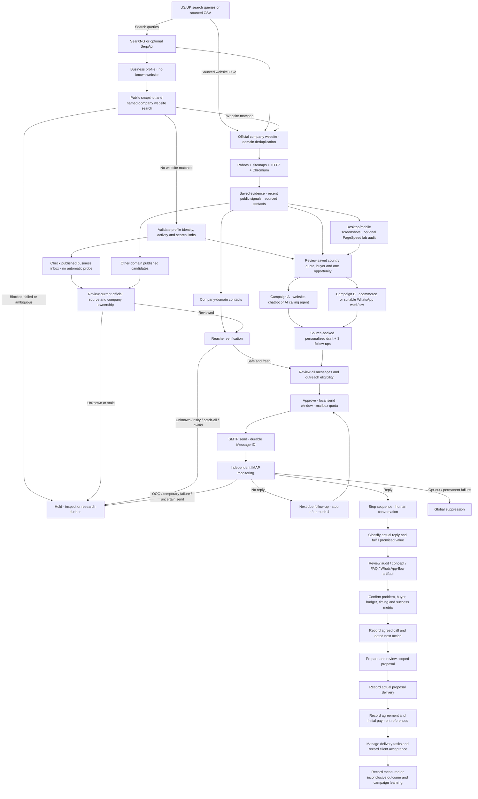

# Profile-first bulk preparation — 21 October 2026

Find prospects can collect a batch with **Business profiles first** and save it to a named
campaign or recurring search. Eligible current first-party profiles pass automatic business,
activity, country, website-lookup and published-inbox checks, then reach one unscheduled email.
CR/CE no longer require per-prospect copying of ownership/qualification notes on that supported
path. Unsupported evidence stays held; final recipient/message approval remains separate.
Collect-first mode is preserved when automatic preparation is OFF; campaign bulk Prepare
runs the same checks later. See [exact source gates and limits](PROFILE_PROSPECTS.md).
The older dated verification counts and live boundaries below remain historical.

# Current live discovery boundaries

Supported-niche searches require industry terms rather than generic adjectives. Explicit conflicting indexed market signals are excluded; an empty relevant search gets one focused retry. Geography and buyer fit still require current official source review. Job/category/search routes cannot establish a website-less business identity. The 575-test current audit and actual eight-segment captures, continuation and restricted-source limits are in [LIVE_LEAD_ACCEPTANCE.md](LIVE_LEAD_ACCEPTANCE.md). No real website-less recipient was accepted.

# Current evidence-to-offer selection

Saved business-facing evidence now supplies stronger booking/product suggestions while legal boilerplate, rejected marketplaces, foreign pages and bare menu labels are excluded. The operator still reviews country, business/buyer fit and one primary offer. Unqualified automatic form prefills use current accepted suggestions without changing saved history. See [source-quality and draft-preview proof](OFFER_SOURCE_QUALITY.md).

# Current review-priority alignment

Review ranking shares the current selected-offer guard used by G/AA/BB and Learning. Future source captures, incomplete or incompatible service review, invalid D2C commerce evidence and countries outside US/UK cannot earn review credit. The complete graph below remains unchanged. See [executed checks and local benchmark](PRIORITY_READINESS.md).

# Current contact-source verification

Company-domain addresses require current official-page publication evidence before verification or outreach. Manual/CSV contacts without proof remain pending. Recipient-page changes invalidate approval, and the maps display publication holds. See [tested behavior and live boundaries](CONTACT_PUBLICATION.md).

# US/UK client acquisition workflow

Current local verification: **537 tests passed**, including five draft-source, thirteen verification-dispatch and four Learning source-freshness regressions. All 35 nodes and 46 connections are mapped to current code and executed checks in [COMPLETE_WORKFLOW_AUDIT.md](COMPLETE_WORKFLOW_AUDIT.md). Current contact recovery is described in [CONTACT_SOURCE_FALLBACK.md](CONTACT_SOURCE_FALLBACK.md). Actual native Reacher startup/API/auth and the earlier catch-all result are documented in [NATIVE_REACHER.md](NATIVE_REACHER.md). The [new live acquisition run](LIVE_ACQUISITION_CURRENT.md) adds one safe/non-catch-all verdict and four unapproved drafts. Safe individual mailboxes, real qualified discovery/contact yield, deployed runtime and actual client outcomes remain separate acceptance; sending is disabled.

Earlier feature release: **288 tests passed**, zero failures, one existing warning, 93.47 seconds. Explainable prospect priorities, exact separate-currency cost/receipt reporting with correction history, and permission-reviewed post-delivery maintenance/expansion/case-study plans are implemented. Full Chromium checks actual forms and desktop/mobile navigation with zero JavaScript errors; normal-server read-only checks preserve all existing operational records and credentials. Calls, payments, agreement, client delivery and publication remain operator-recorded. See [feature details](PRIORITY_FINANCE_AFTERCARE.md) and [current proof](growth-feature-check.json). Older validation sections below are historical.

The dashboard's Workflow view displays this process as connected live stages with per-prospect state and a recommended next action. Map offers Overview (11 stages) and Full workflow (all 35 nodes / 46 connections). Inspect stage / Focus next show saved status, execution mode, conditional routes and an action destination. Node layout is editable; execution rules remain in the application. Settings provides persisted sender/mailbox and login configuration. See [UI_WORKSPACE.md](UI_WORKSPACE.md).

Current verification: [all 35 nodes audited individually](COMPLETE_WORKFLOW_AUDIT.md), with source functions, executed tests, human gates and live limitations. The full map is now available in the dashboard alongside the eleven-stage overview. The audit includes the current suite result and a corrected Reacher readiness check. Deployment setup is user-owned and deferred; it does not prevent local development and is still required for later live acceptance.

Campaign A targets service businesses, agencies and relevant SaaS businesses for better inquiry/booking journeys. Its services include website/new service-page development, website improvement/redesign, chatbots with human handoff, and AI calling agents for phone lead qualification, booking assistance or customer support. Calling-agent selection requires a current positive phone/callback route linked to a specific business task; it is not justified by a generic quote button or poor PageSpeed score. Campaign B targets existing or launching ecommerce/D2C businesses. WhatsApp offers require actual channel fit and appropriate customer opt-in; US/UK stores are not assumed to use WhatsApp.

This diagram describes the business process, including review and operator-recorded external actions. Profile email candidates can be captured before identity review but remain held. Qualification and verification run independently. Sales artifacts/calls depend on what was promised/agreed; the software does not automatically book calls, deliver proposals, collect payments or deploy client services. The detailed audit records these differences explicitly.

LinkedIn company profiles, X, PeoplePerHour and configured business directories are researched automatically through indexed public results, with robots-permitted single-page snapshots where accessible. Website resolution checks explicit links, reciprocal profile links, name/domain/content correlations and ambiguity; these are candidate matches requiring review. New candidates and signals are persisted as they arrive. Company website research then extracts published contacts and queues verification. Indexed/snippet emails stay held until current official-source ownership can be established. Logged-in pages, messaging and bot challenges are not automated. Official company sites remain the deep-crawl source. Profile-only prospects use the current-profile, website-search and contact-ownership branch in `PROFILE_PROSPECTS.md`.

The custom application owns the database, crawler, approval gates, scheduling and reply/suppression state. Reacher owns technical email checks. SearXNG owns search aggregation. n8n can optionally trigger discovery through the app API. Hermes is unnecessary for this pipeline. The workflow manager now includes shared manual activity, client qualification, dated next actions, value artifacts, scoped proposals and recorded agreement/payment/delivery outcomes. External messages, bookings and payments are not performed automatically.

Qualification and verification can proceed independently; approval requires both. Country is supported by an exact quote from a saved official page. A reviewed announcement is optional, and its own source/quote are retained. WhatsApp qualification records channel fit and unknowns. The first email identifies the researched page or announcement; the next touch adds a distinct sourced idea or a practical pilot/measurement suggestion.

Other-domain published addresses remain candidates until company ownership is reviewed against current saved official-page extraction. They are not automatically imported or probed. Source changes invalidate that review; verification, approval/resume and SMTP submission enforce the ownership gate. Public publication, technical validity, buyer relevance and outreach eligibility are separate checks.

The earlier three-part acquisition diagrams apply as business process: (1) discovery and evidence, (2) campaign/service matching, (3) pitch, response and sales conversation. Current-source public signals now propose relevant services without an AI key, while exact-source/business/buyer review still chooses one offer; see [service proposals](SERVICE_PROPOSALS.md). IMAP human replies stop the cold sequence and create a fulfillment task. The operator classifies the actual response, prepares/reviews the promised artifact, confirms need/timing/buyer/budget, records the agreed call, prepares/reviews a proposal and records actual delivery, agreement/payment and client acceptance. Shared manual outreach/replies/opt-outs are centrally logged and block overlapping cold email. Proposal and artifact delivery records are not proof that the app sent a message. Learning now automatically reports frozen campaign/service groups, accepted-record/reply/qualification/recorded-win rates and review guidance; no denominators or legacy context are invented. See [the re-audit](AUDIT.md), [sales workflow details](SALES.md), [learning definitions](LEARNING.md) and [the original-workflow comparison](README_WORKFLOW_CHECK.md).

A new partial/failed research attempt does not erase earlier captures. Those historical pages cannot support new qualification or AI suggestions unless refreshed. The same current-source rule applies to other-domain ownership proof; verification rechecks it and suppression after its spacing wait, before a provider call. Approval/research start serialize under database write transactions, preventing a newly activated sequence from having its research overwritten.
